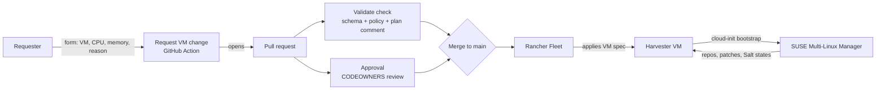

# VM automation with Git, Harvester, Fleet and SUSE Multi-Linux Manager

A small demo of how VM day-2 automation (resize CPU/memory, with approval) works in the SUSE stack, compared with VMware Aria Orchestrator.
See [COMPARISON.md](COMPARISON.md) for the side-by-side comparison.

## How it works



- **Request:** `.github/workflows/request-vm-change.yaml` is a form (Actions tab > Run workflow). It edits `vms/<vm>.yaml` and opens a PR.
- **Validate:** `.github/workflows/validate.yaml` checks the schema, enforces `policy/limits.yaml`, and comments a before/after plan on the PR.
- **Approve:** `.github/CODEOWNERS` routes the review (in a real org: DB VMs to the DBA team, policy changes to platform admins).
- **Schedule (optional):** set *Apply at* on the form and `.github/workflows/scheduled-merge.yaml` merges the approved PR at that time, so the change lands in the maintenance window.
- **Apply:** Fleet (`fleet/gitrepo.yaml`) watches `main` and applies `vms/` to the Harvester cluster. Nobody runs kubectl by hand.
- **No reboot:** VMs have Harvester CPU/memory hot-plug enabled, so increases go live in the running guest. Changes that cannot be applied live (decreases, growth past 4x the boot size) are restarted by `vms/auto-restart.yaml` for VMs labelled `demo.example.com/auto-restart=true`.
- **Inside the guest:** SUSE Multi-Linux Manager registers the VM and manages repos, patches and Salt states. See [suma/](suma/).

Engineers can skip the form and edit the YAML in a PR directly. The same checks and approvals apply.

## Repo layout

```
vms/                 VM definitions (one file per VM) + Fleet bundle config + cloud-init secret
policy/limits.yaml   guardrails (CPU/memory range, required labels, namespaces)
scripts/             validate.sh (policy) and change-summary.sh (PR plan)
fleet/gitrepo.yaml   Fleet GitRepo to register in Rancher
suma/                SUSE Multi-Linux Manager activation/bootstrap notes + Salt baseline state
```

## Setup

1. **Adapt to your cluster:** in `vms/*.yaml`, set the image (`harvesterhci.io/imageId`), the matching storage class and the VM network (the demo uses the pod network). In `vms/suma-bootstrap.secret.yaml`, set the SUSE Multi-Linux Manager host.
2. **GitHub settings:**
   - Point the lines in `.github/CODEOWNERS` at your approver teams.
   - Add a ruleset on `main`: require a PR, require review from Code Owners, and require the `validate` status check.
   - Settings > Actions > General: allow GitHub Actions to create pull requests.
3. **Rancher:** label the Harvester cluster `demo.example.com/vm-gitops=true` and apply `fleet/gitrepo.yaml` (Continuous Delivery). Add a `clientSecretName` if the repo is private.

## Demo script (about 10 minutes)

1. Show `vms/db-01.yaml`: the VM is just a file.
2. Actions > **Request VM change** > db-01, 4 vCPU, 8Gi, reason "INC-1234".
3. Open the PR: the plan comment shows `2 / 4Gi → 4 / 8Gi`, and the review is requested from the code owner.
4. Try 128Gi: the validate check fails on policy, and the PR cannot be merged.
5. Approve and merge the valid PR. In Rancher > Continuous Delivery, the bundle updates. In Harvester, the VM shows the new size (restart required unless hot-plug is enabled).
6. Show the audit trail: who requested it, who approved it, when it was applied, all from Git history.
7. Optional: in SUSE Multi-Linux Manager, show the minion, its channels, and the `vm-baseline` highstate.

## Notes

- Hot-plug shape: annotation `harvesterhci.io/enableCPUAndMemoryHotplug: "true"`, vCPUs as `cpu.sockets` (1 core each), memory as `memory.guest`, and **no** `resources.limits` (limits block live memory changes). Requires KubeVirt `vmRolloutStrategy: LiveUpdate` (Harvester's default). The ceiling is the `max-hotplug-ratio` setting (default 4x the size the VM booted with). `scripts/validate.sh` enforces this shape.
- Switching an existing VM to the hot-plug shape is itself a restart-required change (CPU topology); auto-restart handles it once.
- Scheduled runs on GitHub can start several minutes late, and scheduled workflows in public repos pause after 60 days without commits.
- Fleet ignores fields that Harvester mutates after apply (`vms/fleet.yaml` `comparePatches`), so the bundle stays green.
- In a public repo, GitHub holds the validate run on the first PR opened by `github-actions[bot]` until a maintainer clicks *Approve and run* (first-time contributor rule). After that PR is merged, later requests run automatically. To avoid it entirely, open the PR with a GitHub App token instead of `GITHUB_TOKEN`.
- Each VM pins its `macAddress`. Harvester assigns a random MAC at creation; without pinning, every Fleet re-apply drops it, flags all VMs "restart required", and a restart would change the MAC (breaking DHCP reservations).
